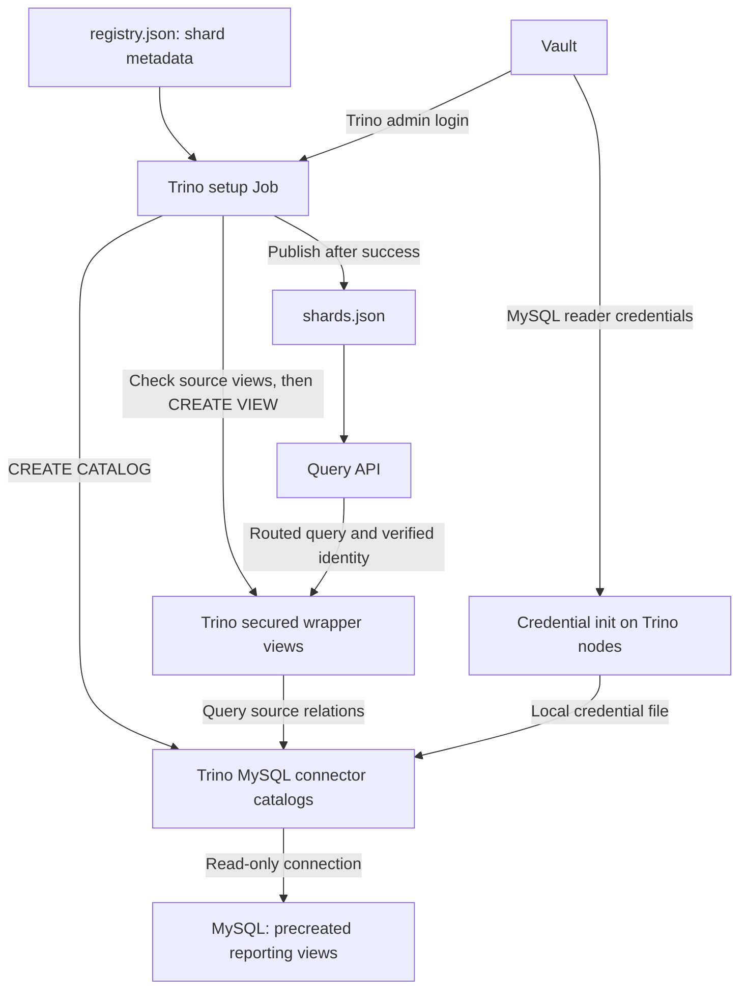

# Reporting view deployment

This repository deploys Trino catalogs and secured Trino wrapper views. MySQL reporting views are **precreated and managed externally**. There is no MySQL DDL command, direct MySQL client dependency, DDL credential configuration, or MySQL deployment Job here.

The six bundled Trino templates use generic source names. Configure matching precreated MySQL views before applying them.

| Relation | Precreated MySQL view in `application` | Trino template in `trino_setup/assets/trino/` |
| --- | --- | --- |
| employee | `reporting_employee` | `employee.txt` |
| expense | `reporting_expense` | `expense.txt` |
| accrual_events | `reporting_accrual_events` | `accrual_events.txt` |
| accrual_balances | `reporting_accrual_balances` | `accrual_balances.txt` |
| department | `reporting_department` | `department.txt` |
| labor_allocation | `reporting_labor_allocation` | `labour_allocation.txt` |

The British template stem `labour_allocation` intentionally creates the US-spelled relation `labor_allocation`. All six Trino templates are included in the Python wheel and Docker image.

## Precreated MySQL dependencies

The external MySQL views contain the business joins, expressions and aggregations. They expose `client_code` and, for employee-level views, `employee_code` and `employee_code_num`. They are tenant-agnostic; access restrictions are applied in the Trino wrappers. The reader account needs SELECT access to these views and the `employee_access` relation (`clientcode`, `username`, `eecode`). Source deployment and replication must make these available on the selected readers before setup.

After creating the source catalogs, this deployment issues `SELECT ... LIMIT 0` through Trino for all six views and `employee_access`, for every selected shard. These are read-only availability checks; the setup process never connects directly to MySQL. Missing dependencies or reader permissions stop deployment before any wrapper is applied. Catalogs already created remain, and the previous published routing snapshot remains unchanged. Wrapper creation subsequently validates the referenced business columns and types.

## Architecture and execution order



1. Existing Trino nodes fetch their MySQL reader credentials from Vault into a mode-0600 file. The reader secret is not needed by the setup Job itself.
2. The setup Job fetches shard metadata from the configured registry URL, filters the requested environment/client ranges, selects read replicas, and assigns stable catalog names.
3. All catalog definitions and wrapper templates are validated locally. Each wrapper needs an explicit proc center; no identity is invented.
4. The setup Job reads its Trino admin credentials from Vault and connects over verified HTTPS. It checks for the configured persistent view catalog, then creates missing source catalogs with a JDBC URL and credential-file reference.
5. The Job checks the precreated MySQL dependencies through those Trino catalogs, then creates one wrapper schema per shard and six wrapper views. Both kinds of DDL execute only in Trino.
6. On success it writes rendered Trino SQL and atomically publishes `shards.json`. The API uses that snapshot to route a client to its shard schema; distribute it and restart the API to refresh its cached routing.

A **source catalog** exposes the remote MySQL database; it does not copy its data or create its views. A **Trino wrapper view** is a stored query in the reporting catalog, adding client/employee restrictions to a precreated MySQL view. The reporting catalog must support storing Trino views and is distinct from the source MySQL connector catalogs.

## Trino layer

The wrappers create `VIEW_CATALOG.<shard_catalog>.<relation>` with `SECURITY DEFINER`. `CURRENT_USER` continues to supply the querying identity (`proc_center|client_code|username`), including in definer views, as specified by [Trino CREATE VIEW](https://trino.io/docs/current/sql/create-view.html).

Every wrapper has a client-code predicate. Employee, expense, accrual_events and accrual_balances additionally correlate `employee_access` by client, username and employee code. Department and labor_allocation intentionally have client-only access. The retired field-1 proc-center row predicate is not restored; the configured proc-center literal is emitted as a column. The renderer validates real SQL syntax and predicates, including employee correlation, rather than searching explanatory comments.

The Vault Trino principal is the view owner; grant it source read access plus catalog/schema/view DDL privileges. Consumers should query the secured wrapper catalog. Cluster authorization must prevent bypass through direct source-catalog access, and identity transport must remain authenticated. Creating views does not configure those cluster policies.

Use a pre-provisioned view-capable persistent catalog for a shared deployment. Set `--view-catalog` if its name differs from `reporting_warehouse`, and align the API's `TRINO_MYSQL_VIEW_CATALOG`. Creating its metastore/storage is outside this deployment. The program fails before catalog mutation if that catalog is missing. For local development, add `--create-memory-view-catalog`; this explicitly creates a memory catalog if absent. Memory schemas and views vanish on coordinator restart even when catalog properties persist.

```sh
# Full offline render from a registry export; renders all six per selected shard:
.venv/bin/trino-setup plan --input examples/registry.json --env-type TEST --proc-center pc1
# Live discovery, catalogs, then reporting wrappers:
.venv/bin/trino-setup apply --env-type TEST --proc-center pc1
# Intentional update of existing wrappers:
.venv/bin/trino-setup apply --env-type TEST --proc-center pc1 --or-replace
```

There is no implicit proc center. Set `--proc-center` or `TRINO_PROC_CENTER` for a deployment with a single center. For mixed centers, `--proc-centers path.json` accepts a map such as `{"mysql_shard_test_7d15cd0f98ce698b":"pc1"}`. Map entries override the global value; unknown shard keys and any unresolved center fail before network writes. Catalog names come from the registry plan. The map is configuration, not credentials.

`plan` and `apply` include views by default. `--catalogs-only` skips wrappers while retaining the online-only source scope and GR-Node3/GR-Node2 restriction. All definitions are validated before connecting. `apply` creates source catalogs first, then wrapper schemas and views. Existing catalogs are skipped; views use strict CREATE unless `--or-replace` is explicit. Changed source endpoints still require catalog reconciliation as described in the main README.

Rendered SQL is written to `<snapshot-directory>/views/<shard>/<stem>.sql` by default, or `--rendered-dir`. After a successful full apply, the routing snapshot is atomically published. SQL DDL is not transactional: on failure, prior successful statements remain, the command exits nonzero, and it does not publish a new snapshot. Review a partial deployment before rerunning with `--or-replace`. The runner stops at the first failing view and suppresses remote error bodies that might expose SQL or credentials.

## Render or reapply without refreshing catalogs

```sh
.venv/bin/trino-setup plan-views --snapshot output/shards.json --proc-center pc1
.venv/bin/trino-setup apply-views --snapshot output/shards.json --proc-center pc1 --or-replace
```

These commands use the supplied snapshot, never refetch the registry, and never recreate source catalogs. They render fresh from the packaged templates rather than consuming arbitrary or stale `.sql` files from the output directory. The snapshot is not modified. Supply the same proc-center configuration and view-catalog name as the original deployment. This is also the recovery path after restarting a development memory catalog.

## API integration

Deploy the source views and credential files, provision the persistent Trino view catalog, and run setup. Distribute the successful routing snapshot to the API and restart it with matching environment, schema, and view-catalog settings. The API owns query routing and authenticated identity transport. MySQL view definitions are managed externally.
